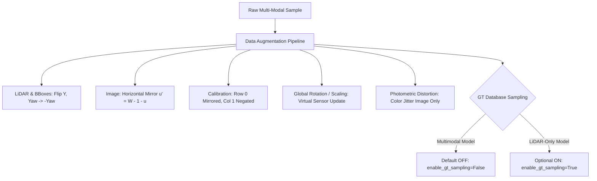

# BEVFusionLite Augmentation Policy & GT Sampling Specification

> **Documentation of Multimodal Data Augmentation and Ground-Truth Sampling Rules**  
> *BEVFusionLite Camera-LiDAR 3D Object Detection Pipeline*

---

## 1. Overview of Multimodal Augmentation

Multimodal 3D detection requires data augmentations to preserve strict geometric alignment between the 3D LiDAR point cloud, 3D bounding boxes, and 2D camera images.



---

## 2. Augmentation Modalities

### 2.1 Horizontal Flip (50% probability)
- **LiDAR Point Cloud**: Reflected across the sagittal plane: $y' = -y$.
- **3D Ground Truth Bounding Boxes**: Center $y' = -y$, heading angle $\theta' = -\theta$.
- **Perspective Image**: Mirrored horizontally: $u' = (W - 1) - u$.
  - When performed on the original image $(375 \times 1242)$, $W = 1242$.
  - When performed on the resized/padded image $(384 \times 1248)$, $W = 1248$.
- **Calibration Update**:
  $$P_2'[0, :] = -P_2[0, :] + (W - 1) \cdot P_2[2, :]$$
  $$T_{\text{v2c}}'[:, 1] = -T_{\text{v2c}}[:, 1]$$
  **Reprojection error**: Identically $0.00\text{ px}$.

### 2.2 Global Rotation & Scaling (Virtual Sensor Extrinsics Update)
- Rather than resampling the camera RGB image via 2D bilinear warping (which introduces blur, invalid boundary padding, and distorts depth geometry), BEVFusionLite updates the sensor extrinsic transform $T_{\text{v2c}}$:
  $$p_{\text{velo}}' = s \cdot R_z(\Delta\theta) \cdot p_{\text{velo}}$$
  $$T_{\text{v2c}}' = T_{\text{v2c}} \cdot R_z(-\Delta\theta) \cdot \text{diag}(1/s, 1/s, 1/s, 1)$$
- Under this formulation:
  $$T_{\text{v2c}}' \cdot p_{\text{velo}}' = T_{\text{v2c}} \cdot p_{\text{velo}}$$
  The 2D projected image coordinates remain completely invariant to machine precision ($< 10^{-6}$).

### 2.3 Photometric Distortion (Image Only)
- Applied only to the RGB camera stream (brightness $\pm 10\%$, contrast $[0.8, 1.2]$, saturation $[0.8, 1.2]$ in HSV space).
- Leaves 3D point cloud and spatial calibration invariant.

---

## 3. Ground Truth (GT) Sampling Policy

### 3.1 What is GT Sampling?
Ground Truth Sampling (OpenPCDet `DataBaseSampler`) pastes 3D bounding box point crops (`gt_database/`) from other training scenes into the current point cloud to balance sparse object classes (such as Pedestrians and Cyclists).

### 3.2 Why GT Sampling MUST be OFF for Multimodal Models
In a multimodal architecture (such as BEVFusionLite with camera and LiDAR branches):
1. **Phantom Objects**: GT sampling pastes LiDAR points from another scene into the current point cloud.
2. **Missing Visual Evidence**: The corresponding RGB camera image does **NOT** contain these pasted objects (the image shows the empty background).
3. **Multimodal Feature Conflict**: The camera feature extractor extracts background features, while the LiDAR branch extracts foreground object points. When the BEV fusion layer combines camera and LiDAR features, it receives contradictory signals:
   - LiDAR branch: "Car present with confidence 0.95"
   - Camera branch: "Empty road/asphalt present with confidence 0.98"
4. **Degradation of Cross-Modal Attention**: The network is penalized during training for trusting the camera branch, directly degrading camera feature quality and multimodal fusion performance.

### 3.3 Configuration Flag Specification
In `bevfusionlite/datasets/kitti_fusion.py`:
```python
class KITTIFusionDataset(Dataset):
    def __init__(
        self,
        data_root: Optional[Union[str, Path]] = None,
        split: str = "train",
        class_names: List[str] = None,
        image_size: Tuple[int, int] = DEFAULT_IMAGE_SIZE,
        point_cloud_range: Optional[np.ndarray] = None,
        augment: bool = True,
        seed: int = 0,
        enable_gt_sampling: bool = False,  # Default OFF for multimodal models
    ):
        ...
        self.enable_gt_sampling = enable_gt_sampling
```

| Configuration | `enable_gt_sampling` | Target Architecture |
|---|---|---|
| **Default (Multimodal)** | `False` | BEVFusionLite (Camera + LiDAR) |
| **LiDAR-Only Ablation** | `True` (optional) | PointPillars, SECOND, VoxelNet |

> **Rule**: For all models with an image branch, `enable_gt_sampling` must remain `False`.
